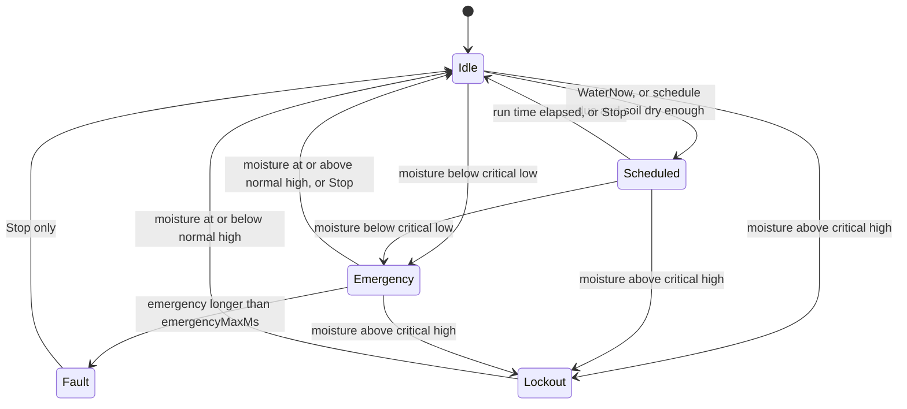

# Watering controller state machine

Source: `lib/watering_controller/watering_controller.cpp`. Rules are evaluated top to bottom, first match wins. `stepController` is called every 100 ms with the moisture percent, the time and a one shot command.

## Rules

| # | Condition | Next mode | Side effects |
|---|---|---|---|
| 1 | `moisturePct > criticalHighPct` | Lockout | none |
| 2 | mode is Lockout and `moisturePct > normalHighPct` | Lockout (hold) | none |
| 3 | mode is Lockout and `moisturePct <= normalHighPct` | Idle | `lastWateredMs = nowMs` |
| 4 | `command == Stop` | Idle | `lastWateredMs = nowMs` (also clears Fault) |
| 5 | mode is Fault | Fault (hold) | none |
| 6 | mode is Emergency and `nowMs - modeStartMs >= emergencyMaxMs` | Fault | none |
| 7 | `moisturePct < criticalLowPct` | Emergency | `modeStartMs = nowMs` only when entering from another mode |
| 8 | mode is Emergency and `moisturePct < normalHighPct` | Emergency (hold) | none |
| 9 | mode is Emergency and `moisturePct >= normalHighPct` | Idle | `lastWateredMs = nowMs` |
| 10 | `command == WaterNow` and mode is Idle | Scheduled | `modeStartMs = nowMs` |
| 11 | mode is Scheduled and `nowMs - modeStartMs >= runMs` | Idle | `lastWateredMs = nowMs` |
| 12 | mode is Scheduled | Scheduled (hold) | none |
| 13 | Idle, `nowMs - lastWateredMs >= scheduleIntervalMs`, `moisturePct >= normalHighPct` | Idle | `lastWateredMs = nowMs` (run skipped, soil already wet) |
| 14 | Idle and `nowMs - lastWateredMs >= scheduleIntervalMs` | Scheduled | `modeStartMs = nowMs` |
| 15 | otherwise | current mode | none |

`runMs = runMsFor(plant.waterMl, flowRateMlPerSec)`.

## Outputs

| Mode | Pump | Alarm |
|---|---|---|
| Idle | off | none |
| Scheduled | on | slow beep (1 s) |
| Emergency | on | fast beep (200 ms) |
| Lockout | off | fast beep |
| Fault | off | fast beep |

Rules 1 to 3 come first, so a remote or button `WaterNow` can never water an overwatered plant. Rule 6 stops the pump after `emergencyMaxMs` when the sensor is stuck low (for example a disconnected probe).
