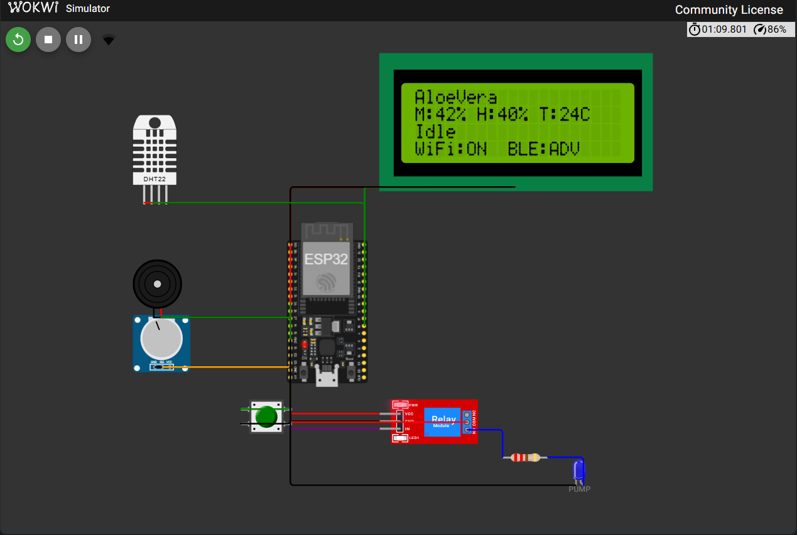

# Wiring

The build is simulated for now. The potentiometer stands in for a soil moisture probe, the LED labelled PUMP stands in for the pump, and the DHT22 is a Wokwi part. The circuit below is the Wokwi simulation of `diagram.json`.

LCD states captured from the simulator: [plant selection](img/lcd_plant_select.png), [pump calibration](img/lcd_calibrating.png), [dry emergency](img/lcd_emergency.png), [idle](img/lcd_idle.png), [too wet lockout](img/lcd_lockout.png).

| Function | ESP32 GPIO | Notes |
|---|---|---|
| Moisture input (potentiometer wiper or probe) | 34 | ADC1, input only, safe with WiFi |
| Relay (pump) | 26 | active level set by `kRelayActiveLow` |
| Buzzer | 27 | HIGH = sound |
| Button | 25 | `INPUT_PULLUP`, pressed = LOW |
| DHT22 data | 23 | one reading every 2 s at most |
| LCD RS / E | 16 / 17 | 4 bit parallel mode |
| LCD D4 / D5 / D6 / D7 | 18 / 19 / 21 / 22 | |
| LCD RW | GND | write only |

ADC2 pins do not work while WiFi is on, so moisture uses ADC1. GPIO 6 to 11 (flash) and the strapping pins 0, 2, 5, 12, 15 are not used.

All pins are defined only in `include/autwat_config.h`.
